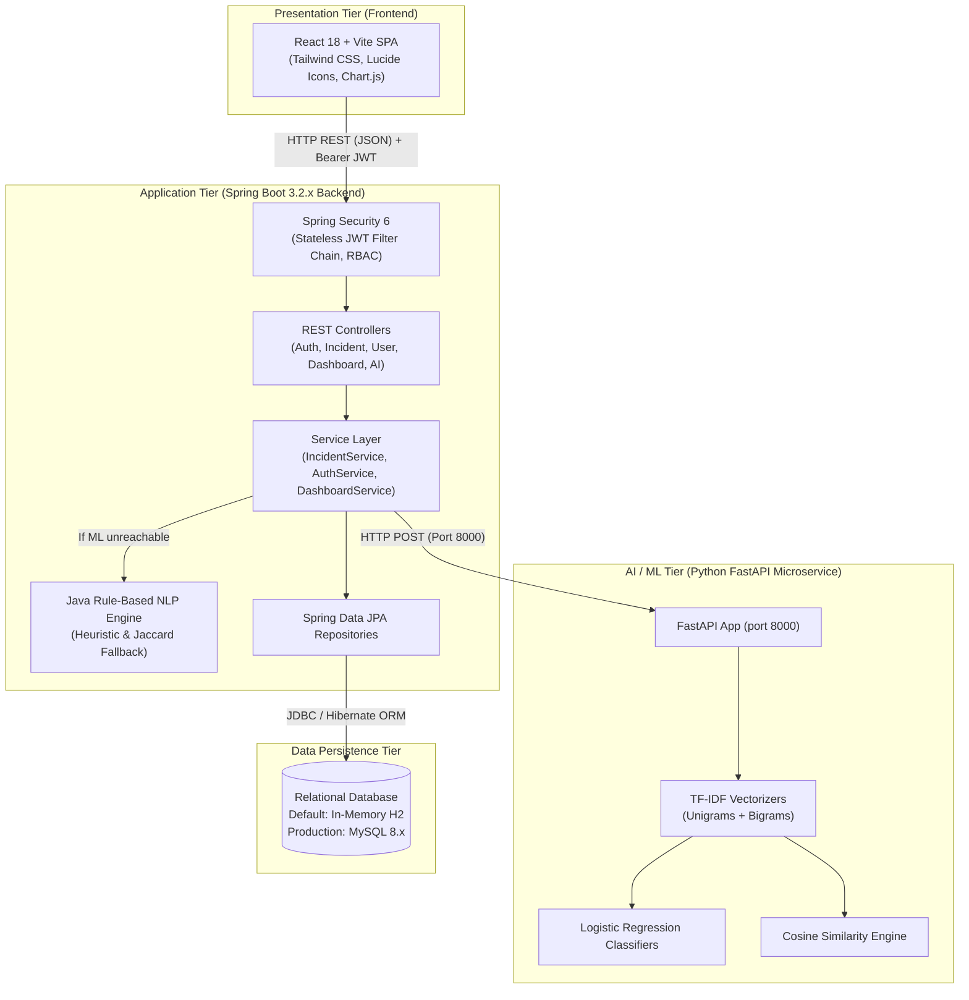
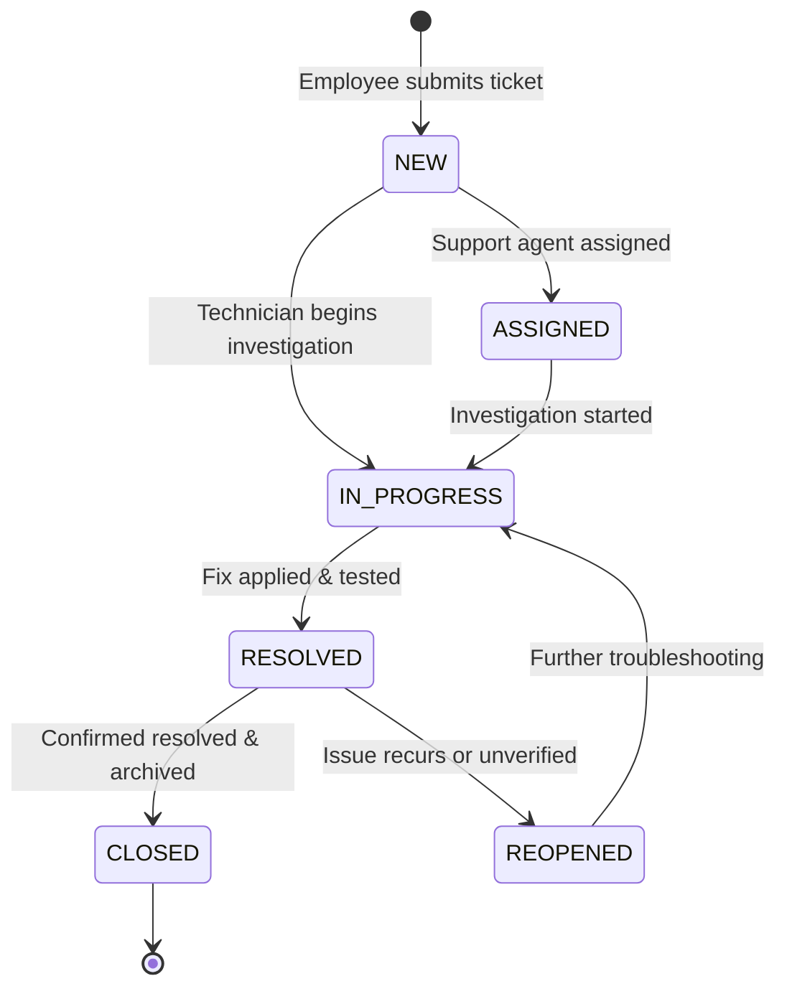

# Intelligent IT Support & Incident Management System (ITSM)
## Comprehensive Technical Documentation & Architecture Guide

---

## 1. Executive Summary & Problem Statement

### 1.1 Overview
The **Intelligent IT Support & Incident Management System** is an enterprise-grade, full-stack service desk platform. It streamlines the reporting, categorization, priority evaluation, assignment, resolution, and tracking of IT incidents within an organization. 

What distinguishes this system from conventional ticketing software is its **integrated Artificial Intelligence (NLP) microservice** that:
- Automatically predicts the appropriate **ticket category** from the user's plain-English title and description.
- Automatically estimates the **urgency/priority level** (`LOW`, `MEDIUM`, `HIGH`, `CRITICAL`).
- Performs **live semantic duplicate detection** using TF-IDF and Cosine Similarity to prevent duplicate tickets from cluttering the support queue.

### 1.2 The Problem Being Solved
In traditional IT helpdesk setups:
1. **Manual Triage Overhead**: Tier-1 support staff must spend hours manually reading, classifying, and assigning incoming incident reports.
2. **Inconsistent Priority Ratings**: End-users often classify every minor issue as "Urgent" or "Critical", distorting Service Level Agreements (SLAs).
3. **Duplicate Ticket Storms**: When an enterprise system (like an email server, ERP, or office Wi-Fi) fails, dozens of employees independently file identical tickets for the same underlying outage.
4. **Lack of Lifecycle Auditability**: Without an immutable audit trail, tracking who changed ticket priority, when status shifted, or what technician worked on the issue becomes impossible.

### 1.3 Project Solution
This project addresses all four challenges:
- **Fast automated triage** via multi-class text classification (Python FastAPI + Scikit-Learn).
- **Graceful Java heuristic fallback** ensuring 100% backend uptime even if the ML service is unreachable.
- **Real-time duplicate detection alerts** displayed right on the frontend as the user types.
- **Strict status state machines** and an immutable `incident_history` audit table.

---

## 2. End-to-End System Architecture

The application adopts a **decoupled, multi-tier microservice-friendly architecture**:



---

## 3. Technology Stack & Technical Justifications

| Layer | Technology | Version | Justification |
| :--- | :--- | :--- | :--- |
| **Backend Framework** | **Java & Spring Boot** | Java 17, Spring Boot 3.2.3 | Industry gold standard for enterprise backends. Robust dependency injection, transactional integrity, and mature data access libraries. |
| **Security & Auth** | **Spring Security & JJWT** | 6.x, JJWT 0.11.5 | Stateless authentication via signed JSON Web Tokens (HMAC-SHA256). Scales horizontally without server-side HTTP session overhead. |
| **Persistence (ORM)** | **Spring Data JPA / Hibernate** | 3.2.x | Eliminates error-prone raw JDBC boilerplate. Manages relational mapping, entity lifecycles, and automatic schema validation. |
| **Primary Database** | **H2 Database / MySQL 8.x** | — | **H2** provides zero-configuration evaluation on any machine. **MySQL** provides enterprise multi-threaded ACID persistence. |
| **Frontend Framework** | **React & Vite** | React 18, Vite 5.4 | Component-based, lightning-fast HMR (Hot Module Replacement), optimized bundle creation (under 40 seconds). |
| **Styling & UI** | **Tailwind CSS & Lucide Icons** | Tailwind 3.4 | Modern utility-first CSS, responsive dark-mode styling, clean iconography. |
| **Data Visualization** | **Chart.js & react-chartjs-2** | 4.x | Renders interactive canvas charts (Category breakdowns, priority donuts, agent workloads). |
| **AI / ML Runtime** | **Python, FastAPI, Uvicorn** | Python 3.11+, FastAPI 0.110+ | FastAPI provides asynchronous REST endpoints with high throughput. Scikit-learn offers tested, mathematically proven NLP algorithms. |

---

## 4. Deep Dive into the Machine Learning Microservice

### 4.1 Feature Extraction: TF-IDF Vectorization
Raw textual ticket descriptions cannot be directly processed by mathematical classifiers. The text is transformed into numerical vectors using **Term Frequency-Inverse Document Frequency (TF-IDF)**:

$$\text{TF}(t, d) = \frac{\text{Count of term } t \text{ in ticket } d}{\text{Total terms in ticket } d}$$

$$\text{IDF}(t) = \log\left(\frac{1 + N}{1 + \text{df}(t)}\right) + 1$$

$$\text{TF-IDF}(t, d) = \text{TF}(t, d) \times \text{IDF}(t)$$

- **N-gram Range (1, 2)**: Both single words (*"vpn"*, *"printer"*) and two-word phrases (*"blue screen"*, *"spooler error"*, *"access denied"*) are captured.
- **English Stop Words**: Common words (*"the"*, *"and"*, *"in"*, *"is"*) that carry zero semantic discriminative weight are removed.

### 4.2 Category & Priority Classification: Logistic Regression
The classifier computes the class probability distribution using the **Softmax function**:

$$P(Y = C_k \mid X) = \frac{e^{w_k^T X + b_k}}{\sum_{j=1}^{K} e^{w_j^T X + b_j}}$$

The model predicts the category class with the highest posterior probability:

$$\hat{y} = \arg\max_k P(Y = C_k \mid X)$$

Supported categories:
- `Hardware`, `Software`, `Network`, `Email`, `Access/Login`, `Security`, `Database`, `Printer`, `Other`.

Supported priorities:
- `LOW`, `MEDIUM`, `HIGH`, `CRITICAL`.

### 4.3 Duplicate Ticket Detection: Cosine Similarity
When a user types a new ticket, the system compares its TF-IDF vector $\vec{q}$ against existing active incident vectors $\vec{d}$:

$$\text{Similarity}(\vec{q}, \vec{d}) = \cos(\theta) = \frac{\vec{q} \cdot \vec{d}}{\|\vec{q}\|_2 \|\vec{d}\|_2} = \frac{\sum_{i=1}^{n} q_i d_i}{\sqrt{\sum_{i=1}^{n} q_i^2} \cdot \sqrt{\sum_{i=1}^{n} d_i^2}}$$

- **Threshold**: When $\text{Similarity} \ge 0.65$ (65%), the system alerts the employee that an identical issue has already been reported, displaying the matching ticket number and title.

### 4.4 Resilient Dual-Engine Fallback
If the Python microservice is offline or unreachable:
1. `AiIntegrationService.java` catches the `RestClientException`.
2. It immediately executes an in-memory Java NLP parser with pre-configured domain keywords.
3. For duplicate checks, it computes a set-based **Jaccard Similarity coefficient**:
   $$J(A, B) = \frac{|A \cap B|}{|A \cup B|}$$
4. The user's request **never crashes**, ensuring high service availability.

---

## 5. Database Design & Entity Relationships

The relational schema is composed of **four interconnected tables**:

```
+----------------------------------+          +-----------------------------------------+
|              users               |          |                incidents                |
+----------------------------------+          +-----------------------------------------+
| PK id              BIGINT        |          | PK id                  BIGINT           |
|    name            VARCHAR(255)  |          |    ticket_number       VARCHAR(50) [UQ] |
|    email           VARCHAR(255)UQ|          |    title               VARCHAR(255)     |
|    password        VARCHAR(255)  |          |    description         TEXT             |
|    role            VARCHAR(50)   |          |    category            VARCHAR(50)      |
|    department      VARCHAR(100)  |          |    predicted_category  VARCHAR(50)      |
|    active          BOOLEAN       |          |    category_confidence DOUBLE           |
|    created_at      DATETIME      |          |    priority            VARCHAR(50)      |
+----------------------------------+          |    predicted_priority  VARCHAR(50)      |
                |                             |    priority_confidence DOUBLE           |
                | 1                           |    status              VARCHAR(50)      |
                |                             | FK created_by          BIGINT           |
                |                             | FK assigned_to         BIGINT           |
                +----------+                  |    department          VARCHAR(100)     |
                |          |                  |    location            VARCHAR(100)     |
                |          |                  |    created_at          DATETIME         |
                | N        | N                |    updated_at          DATETIME         |
+-----------------------+  |                  |    resolved_at         DATETIME         |
|   incident_comments   |  |                  +-----------------------------------------+
+-----------------------+  |                                       | 1
| PK id          BIGINT |  |                                       |
| FK incident_id BIGINT |  |                                       |
| FK user_id     BIGINT |  |                                       | N
|    comment     TEXT   |  |                  +-----------------------------------------+
|    created_at  DATETIME  |                  |            incident_history             |
+-----------------------+  |                  +-----------------------------------------+
                           +----------------->| PK id                  BIGINT           |
                             1              N | FK incident_id         BIGINT           |
                                              | FK changed_by          BIGINT           |
                                              |    old_status          VARCHAR(50)      |
                                              |    new_status          VARCHAR(50)      |
                                              |    old_priority        VARCHAR(50)      |
                                              |    new_priority        VARCHAR(50)      |
                                              |    action_note         VARCHAR(255)     |
                                              |    changed_at          DATETIME         |
                                              +-----------------------------------------+
```

### Table Details:
1. **`users`**: Stores credentials (BCrypt hashed), department, active state flag, and roles (`ROLE_EMPLOYEE`, `ROLE_SUPPORT_AGENT`, `ROLE_ADMIN`).
2. **`incidents`**: Stores ticket details, AI predictions vs user overrides, assigned agent foreign keys, and timestamps (`created_at`, `updated_at`, `resolved_at`).
3. **`incident_comments`**: Supports interactive discussions between employees and support agents on a specific ticket.
4. **`incident_history`**: Immutable compliance audit log recording every assignment, priority override, and status update.

---

## 6. Backend Software Architecture & Design Patterns

The Spring Boot backend strictly follows **Separation of Concerns (SoC)**:

### 6.1 Layering
- **Controller Layer** (`com.example.itsupport.controller`): Receives HTTP requests, performs parameter validation via `@Valid`, and delegates to services. No SQL or business rules exist here.
- **Service Layer** (`com.example.itsupport.service`): Contains business logic, authorization rules, transaction boundaries (`@Transactional`), status state machine validation, and audit recording.
- **Data Access Layer** (`com.example.itsupport.repository`): Spring Data JPA repository interfaces executing derived queries and optimized JPQL aggregations.
- **Security Layer** (`com.example.itsupport.security`): Custom JWT filter (`OncePerRequestFilter`), user details service, and token provider.

### 6.2 Design Patterns Utilized
- **Singleton Pattern**: All Spring `@Service`, `@Repository`, and `@Component` classes are managed as singletons.
- **Data Transfer Object (DTO) Pattern**: Entities (`Incident`, `User`) are never exposed directly to the REST API. Strongly typed DTOs (`IncidentRequest`, `IncidentResponse`, `UserDto`) decouple the database schema from the API contract.
- **Builder Pattern**: Applied via Lombok `@Builder` on entities and DTOs for readable, immutable object construction.
- **Dependency Injection (Inversion of Control)**: Loose coupling achieved via constructor injection with `@RequiredArgsConstructor`.
- **Strategy / Fallback Pattern**: In `AiIntegrationService`, remote FastAPI call is the primary strategy; internal Java NLP heuristic is the fallback strategy.

---

## 7. Role-Based Access Control (RBAC) & Security Architecture

### Role Matrix

| Capability / API Endpoint | `ROLE_EMPLOYEE` | `ROLE_SUPPORT_AGENT` | `ROLE_ADMIN` |
| :--- | :---: | :---: | :---: |
| Self-register an account (`POST /api/auth/register`) |  (Forces EMPLOYEE) | ❌ | ❌ |
| Submit Incident Ticket (`POST /api/incidents`) |  |  |  |
| View Personal Incident History (`GET /api/incidents`) |  (Scoped to own tickets) |  (All tickets) |  (All tickets) |
| Add Comments to Ticket (`POST /api/incidents/{id}/comments`) |  |  |  |
| Assign Ticket to Agent (`PUT /api/incidents/{id}/assign`) | ❌ |  |  |
| Transition Ticket Status (`PUT /api/incidents/{id}/status`) | ❌ |  |  |
| Override Ticket Priority (`PUT /api/incidents/{id}/priority`) | ❌ |  |  |
| View Support Analytics Dashboard (`GET /api/dashboard/statistics`) | ❌ |  |  |
| Create New Agents or Admins (`POST /api/users`) | ❌ | ❌ |  |
| Disable/Enable User Accounts (`PUT /api/users/{id}/toggle-status`) | ❌ | ❌ |  |

---

## 8. Incident Lifecycle State Machine

Incidents move through a strictly validated finite state machine implemented in `IncidentService.validateStatusTransition()`:



- Invalid transitions (such as jumping directly from `NEW` to `CLOSED`) are immediately rejected with a `400 Bad Request`.
- `CLOSED` incidents are permanently locked from modifications.

---

## 9. Step-by-Step Live Demonstration Script (For Interviews & Viva)

Follow this 5-minute walkthrough to demonstrate the system effectively:

### Step 1: Start the Entire System
Double-click `run_all.bat`. Within 30 seconds, all 3 tiers will be running:
- Python ML microservice: `http://localhost:8000`
- Spring Boot backend: `http://localhost:8080`
- React Vite frontend: `http://localhost:5173`

### Step 2: Employee Workflow & Real-Time AI
1. Open `http://localhost:5173` and log in as **`john.doe@enterprise.com`** (Password: `Password123!`).
2. Click **"Report Incident"** in the sidebar.
3. Type Title: `Outlook application crashing continuously when sending emails`
4. Click **"AI Auto-Predict"**:
   - The AI will automatically classify Category as **Software** and Priority as **HIGH** with confidence percentages.
5. In the Title, type: `Unable to connect to office Wi-Fi network in Block B`
   - Notice the amber banner: **"Potential Duplicate Incident Detected! (95.0% similarity with INC-1001)"**.
6. Submit the ticket &mdash; it generates a deterministic ticket number (e.g., `INC-1031`) and opens your ticket history.

### Step 3: Support Agent Queue & Ticket Triage
1. Click **Logout**, then log in as **`agent.smith@itsupport.com`** (Password: `Password123!`).
2. Click **"All Incident Queue"**:
   - Filter by Category (*Network*), Priority (*Critical*), or Status (*New*).
3. Find an unassigned ticket, click **"Assign"**, select **Agent Sarah Jones**, and save.
4. Click **"Status"**, change to **IN_PROGRESS**, enter a technician note, and update.
5. Click **"Priority"**, escalate the priority to **CRITICAL**, and record the justification.
6. Click **"View"** to open the full ticket timeline &mdash; observe the **Incident Audit Lifecycle Timeline** showing every action with precise timestamps and technician names.

### Step 4: Support Desk Service Analytics
1. Click **"Analytics & Desk"**:
   - Show the dynamic Chart.js charts: **Category Distribution**, **Priority Breakdown**, **Department Breakdown**, and **Agent Workload**.
   - Show the **Mean Time to Resolution (MTTR)** calculation computed from live database records.

### Step 5: System Administrator Account Management
1. Log in as **`admin@itsupport.com`** (Password: `Password123!`).
2. Open **"User Management"**:
   - Click **"Disable"** on a user account to deactivate login permissions.
   - Click **"Provision New User"** to create a new `SUPPORT_AGENT` or `ADMIN`.

---

## 10. Placement Interview Questions & Answers

### Q1: Why did you separate the Machine Learning service from the Spring Boot backend?
> **Answer**: *"I separated them using a microservices approach for three reasons:*
> *1. **Ecosystem Fit**: Python has rich, optimized scientific libraries like Scikit-Learn, NumPy, and Pandas, whereas Java is superior for enterprise business logic, transaction management, and security.*
> *2. **Independent Scalability**: In a large enterprise, the ML inference engine can be scaled or deployed on GPU-enabled instances independently of the backend API.*
> *3. **Fault Tolerance**: Our Spring Boot backend implements a fallback mechanism. If the ML microservice goes offline, our Java heuristic rules immediately take over, so end-users never experience a service outage."*

### Q2: How does your JWT authentication work under the hood?
> **Answer**: *"We use a stateless JWT filter pipeline:*
> *When a user logs in via `POST /api/auth/login`, Spring Security's `AuthenticationManager` verifies the BCrypt-hashed password. Once verified, `JwtTokenProvider` signs an HMAC-SHA256 token containing the user ID, email, and authority claims.*
> *On subsequent requests, the frontend sends this token in the `Authorization: Bearer <token>` header. Our custom `JwtAuthenticationFilter` intercepts the request before it reaches Spring's authorization filters, validates the signature, extracts the user details, and sets the authenticated `UserPrincipal` into Spring's `SecurityContextHolder`."*

### Q3: What is the N+1 problem in JPA and how did you address it?
> **Answer**: *"The N+1 query problem occurs when an entity has relationships (like `@ManyToOne`) and fetching N child entities executes 1 query to fetch the parents plus N subsequent queries to fetch each related record.*
> *In our system, we keep repository queries clean, use targeted JPQL group-by aggregations for dashboard analytics to avoid loading full entity graphs into memory, and bound duplicate check queries using `findTop100ByOrderByCreatedAtDesc()` rather than full unbounded table scans."*

### Q4: How does your duplicate incident detection work?
> **Answer**: *"We use a Natural Language Processing pipeline based on TF-IDF text representation and Cosine Similarity:*
> *1. The text is normalized (lowercased, stop words removed, tokenized into unigrams and bigrams).*
> *2. Each ticket is represented as a high-dimensional vector weighted by term frequency and inverse document frequency.*
> *3. The Cosine Similarity calculates the dot product divided by the product of vector magnitudes, yielding a score between 0.0 and 1.0.*
> *4. If the score is $\ge 0.65$, our system flags it as a duplicate, alerting the employee to avoid redundant ticket submissions."*

### Q5: What security protections are implemented in this project?
> **Answer**:
> *1. **Password Hashing**: BCrypt with salted rounds &mdash; passwords are never stored in plaintext.*
> *2. **Role Boundaries**: Public registration forces `ROLE_EMPLOYEE`; privilege escalation attacks are prevented at the service layer.*
> *3. **CORS Configuration**: Restricts permitted HTTP methods and headers.*
> *4. **SQL Injection Prevention**: Spring Data JPA uses parameterized prepared statements under the hood.*
> *5. **XSS & Bean Validation**: Incoming requests are validated using Jakarta Bean Validation (`@NotBlank`, `@Size`, `@Email`).*

